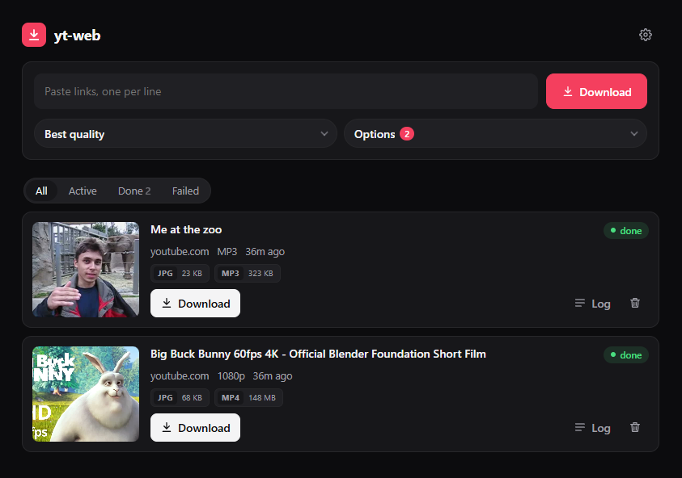

# yt-web

Minimal, no-auth web frontend for yt-dlp, for personal use. It uses only the Python standard library (no framework and no JS build). The server idles at about 20 MB of RAM.



Paste links, pick a format, and downloads run on the server in the background. Close the tab and come back later; every file (video, audio, thumbnail, subtitles…) stays available to download.

## Setup
```sh
sudo apt install -y python3-venv ffmpeg
python3 -m venv .venv
.venv/bin/pip install "yt-dlp[default]" deno
```
`deno` is needed for YouTube's JS challenges. `ffmpeg` is needed for merging, MP3 and embedding. Tools in `.venv/bin` are found first, then the system `PATH`, so apt-installed ffmpeg/deno work too.

<details><summary>No sudo / no python3-venv?</summary>

```sh
python3 -m venv --without-pip .venv
curl -sSL https://bootstrap.pypa.io/get-pip.py | .venv/bin/python
.venv/bin/pip install "yt-dlp[default]" deno static-ffmpeg
.venv/bin/static_ffmpeg_paths   # downloads ffmpeg; then move ffmpeg+ffprobe into .venv/bin
```
</details>

## Run
```sh
.venv/bin/python server.py      # http://127.0.0.1:8080
```
Env vars: `HOST` (default `127.0.0.1`), `PORT` (8080), `MAX_JOBS` (parallel downloads, 2), `DATA_DIR` (`./downloads`), `COOKIES_FILE` (`./cookies.txt`).

Stopping the server does not stop running downloads.

### As a service (systemd)
`/etc/systemd/system/yt-web.service`:
```ini
[Unit]
Description=yt-web
After=network-online.target

[Service]
User=USER
WorkingDirectory=/home/USER/yt-web
Environment=HOST=127.0.0.1 PORT=8080 MAX_JOBS=2
ExecStart=/home/USER/yt-web/.venv/bin/python server.py
Restart=on-failure
# Only stop the web server; let running downloads finish on their own
KillMode=process

[Install]
WantedBy=multi-user.target
```
```sh
sudo systemctl daemon-reload && sudo systemctl enable --now yt-web
```

## How it works
- Each job is a folder `downloads/<id>/`: `job.json` (url+options), `log.txt`, `rc` (exit code), and the files themselves.
- yt-dlp runs as a detached process (own session) wrapped by `sh`, which writes `rc` when it exits. Downloads keep going after the browser closes and even while the server is stopped. The server only reads state from disk.
- Jobs killed by a reboot are re-queued automatically on the next start, and yt-dlp resumes the `.part` files.

## Cookies (YouTube "Sign in to confirm you're not a bot")
Open ⚙ in the page header, then paste or upload a Netscape `cookies.txt` exported from a logged-in browser (see the [yt-dlp guide](https://github.com/yt-dlp/yt-dlp/wiki/Extractors#exporting-youtube-cookies)). It is saved to `cookies.txt` next to `server.py` with mode 600. It is never served over HTTP. Each job gets a private copy, which is deleted when the job ends. A spare Google account is the safer choice.

## Update yt-dlp (do this when YouTube breaks)
```sh
.venv/bin/pip install -U "yt-dlp[default]"
```

## Security
There is no auth. Keep `HOST=127.0.0.1` and reach it through Tailscale (`tailscale serve --bg 8080`) or a reverse proxy with a password (e.g. Caddy `basic_auth`). Never expose the port directly: anyone who can reach it can download to and delete from your disk.
